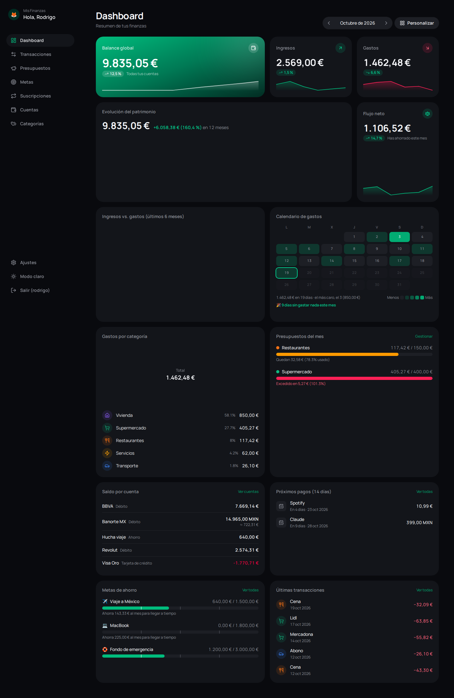
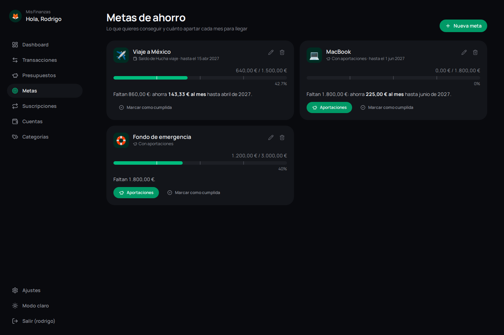
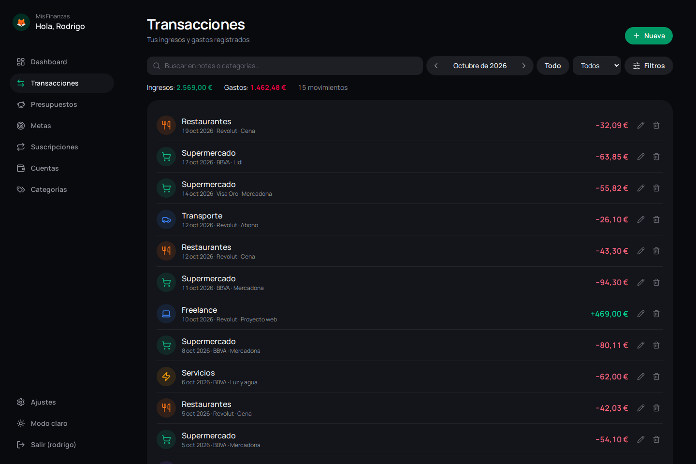
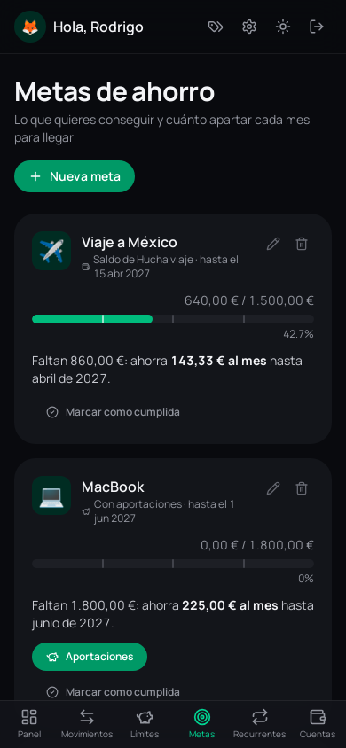

# Finanzas Personales

[](https://github.com/RODknight22/appFinanzas/actions/workflows/ci.yml)
[](LICENSE)

App de finanzas personales que funciona **en tu ordenador**. Tus datos se quedan contigo: no hay
cuentas en la nube, ni anuncios, ni nadie más que vea en qué gastas.

Pensada para quien maneja **varias monedas**: cobras en una, gastas en otra y quieres saber cuánto
tienes en total sin hacer cuentas a mano.



## Qué puedes hacer

- **Panel personalizable**: balance global, ingresos y gastos con su tendencia, evolución de tu
  patrimonio, calendario de gastos, presupuestos y más. Ordena los widgets arrastrándolos y elige
  su tamaño.
- **Transacciones**: búsqueda sin importar tildes ni mayúsculas, filtros por cuenta, categoría,
  importe y fecha.
- **Importar extractos** del banco en CSV o Excel: sin configurar columnas, sin duplicados,
  aprendiendo la categoría de cada concepto y con tus propias reglas ("contiene MERCADONA →
  Supermercado"). Los cambios entre tus cuentas cuentan como transferencias, no como ingresos.
- **Cuentas**: débito, tarjetas de crédito (con fecha de corte, de pago y límite) y cuentas con
  rendimientos diarios. El **efectivo** tiene su pestaña, con subcuentas (cartera, hucha…).
- **Transferencias** entre cuentas, también entre monedas: guarda el tipo de cambio real que te
  aplicó el banco y te dice cuánto te costó frente a la tasa del BCE de ese día, con el total del
  año en el panel. Pagar la tarjeta es un clic.
- **Poder adquisitivo**: si cobras en una moneda y gastas en otra, cuánto rinde tu dinero este
  mes frente a la media de 12 meses.
- **Multidivisa**: peso mexicano, dólar, euro, quetzal, lempira y los pesos colombiano, argentino y
  chileno y el sol peruano. Cada movimiento se convierte con la tasa del día en que ocurrió; las
  tasas se actualizan solas y puedes corregirlas a mano.
- **Metas de ahorro** que siguen el saldo de una cuenta o tus aportaciones, te dicen cuánto apartar
  al mes y lo celebran contigo al llegar al 25, 50, 75 y 100 %.
- **Lista de deseos** junto a tus metas, y **deudas**: quién te debe y a quién debes.
- **Presupuestos** por categoría (se repiten de un mes a otro con un toque) y **pagos fijos**:
  suscripciones e ingresos fijos (como el sueldo), con avisos de los próximos en la campana.
- **Copia de seguridad** de un clic y exportación de tus movimientos a CSV.
- **Personalización**: 5 estilos con versión clara y oscura, 12 colores de acento, foto de perfil,
  página de inicio y día en que empieza tu "mes" (por ejemplo, el día de cobro).

| Metas de ahorro | Transacciones | En el móvil |
| --- | --- | --- |
|  |  |  |

## Instalación

Descarga la última versión desde la página de
[**Releases**](https://github.com/RODknight22/appFinanzas/releases/latest).

### Windows

1. Descarga `AppFinanzas-vX.Y.Z-windows.exe`.
2. Haz doble clic. Se abrirá una ventana negra (esa ventana **es** la app) y, después, tu navegador.
3. La primera vez, Windows puede mostrar *"Windows protegió su PC"*: el ejecutable no está firmado
   con un certificado de pago. Pulsa **Más información → Ejecutar de todas formas**.

### Linux

```bash
chmod +x AppFinanzas-vX.Y.Z-linux
./AppFinanzas-vX.Y.Z-linux
```

### Docker (para usuarios técnicos)

```bash
docker run -d --name finanzas -p 127.0.0.1:8000:8000 -v finanzas:/data \
  --restart unless-stopped ghcr.io/rodknight22/appfinanzas:latest
```

Abre <http://127.0.0.1:8000>. El `127.0.0.1` hace que solo tu ordenador pueda entrar; los datos
viven en el volumen `finanzas`. La imagen usa la hora de España; si vives en otra zona, añade
`-e TZ=America/Mexico_City` (o la tuya) para que "hoy" y el mes actual cuadren.

### Comprobar la descarga (opcional)

Cada versión incluye `SHA256SUMS.txt` con la huella de cada archivo. Si coincide, el archivo es
exactamente el que se publicó:

```bash
sha256sum AppFinanzas-vX.Y.Z-linux          # Linux
certutil -hashfile AppFinanzas-vX.Y.Z-windows.exe SHA256   # Windows
```

## Uso

- **Primera vez**: crea tu usuario y contraseña (mínimo 8 caracteres). Es un único usuario local.
- **Cerrar la app**: cierra la ventana de la consola. **Abrirla de nuevo**: doble clic otra vez; si
  ya estaba abierta, solo se abre otra pestaña.
- **Dónde están tus datos**: en un único archivo `finance.db` dentro de
  - Windows: `%APPDATA%\AppFinanzas`
  - Linux: `~/.local/share/AppFinanzas`
- **Copia de seguridad**: en **Ajustes → Seguridad y datos**, "Descargar copia completa" guarda la
  base de datos (para restaurarla, cierra la app y sustituye `finance.db` por el archivo
  descargado). También puedes, con la app **cerrada**, copiar esa carpeta entera a otro sitio.
- **¿Olvidaste la contraseña?** Ejecuta la app con `--restablecer-contrasena` (en Docker:
  `docker exec finanzas python -m app.restablecer_contrasena`). Se borra el usuario, **no** tus
  datos: al abrirla, creas uno nuevo.

## Privacidad y seguridad

- La app **solo escucha en tu propio ordenador** (`127.0.0.1`): nadie de tu red puede conectarse.
- Lo único que sale a internet es la descarga diaria de tasas de cambio desde
  [ExchangeRate-API](https://www.exchangerate-api.com). No se envía ningún dato tuyo.
- Contraseña guardada con *scrypt* (nunca en claro); sesión en una cookie que JavaScript no puede
  leer; bloqueos crecientes tras varios intentos fallidos.
- Protecciones frente a webs maliciosas abiertas en el mismo navegador (comprobación de `Host` y
  `Origin`, política de seguridad de contenido estricta).
- La carpeta de datos solo es accesible para tu usuario del sistema. La base de datos **no está
  cifrada**: protege tu ordenador con contraseña.
- ¿Encontraste un fallo de seguridad? Escríbeme de forma privada desde mi perfil de GitHub antes de
  publicarlo.

## Desarrollo

Solo necesitas [Docker](https://www.docker.com/products/docker-desktop/).

```bash
git clone https://github.com/RODknight22/appFinanzas.git
cd appFinanzas
docker compose up --build     # web en http://localhost:5173 · API en http://localhost:8000/docs
```

El desarrollo usa su propia BD en `data-dev/` (nunca tus datos reales) y el puerto 8000 tiene
las mismas defensas de Host y Origin que la versión publicada.

| Carpeta | Contenido |
| --- | --- |
| `backend/app` | API con FastAPI + SQLModel + SQLite (routers → services → models) |
| `backend/tests` | Tests con pytest |
| `frontend/src` | React 18 + TypeScript + Tailwind v4 + Recharts |
| `empaquetado/` | Receta de PyInstaller para los ejecutables |
| `e2e/` | Pruebas en el navegador con Playwright |
| `.github/workflows` | CI (linters, tests, tipos y E2E) y publicación de versiones |

```bash
scripts/verificar.sh          # linters, tests del backend y tipos del frontend
scripts/verificar.sh --e2e    # además recorre la app en un navegador (Playwright)
```

**Publicar una versión**: cambia `backend/app/version.py` y `frontend/package.json`, añade los
cambios a `CHANGELOG.md` y `NOTAS_RELEASE.md`, y sube una etiqueta:
`git tag v1.3.0 && git push origin v1.3.0`. GitHub Actions fabrica los ejecutables y la imagen
Docker y crea el Release.

## Licencia

[GPL-3.0](LICENSE): puedes usar, estudiar, modificar y compartir esta app; si distribuyes una
versión modificada, debe seguir siendo software libre bajo la misma licencia.

© 2026 Rodrigo (RODknight22)
