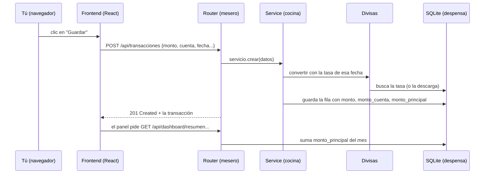
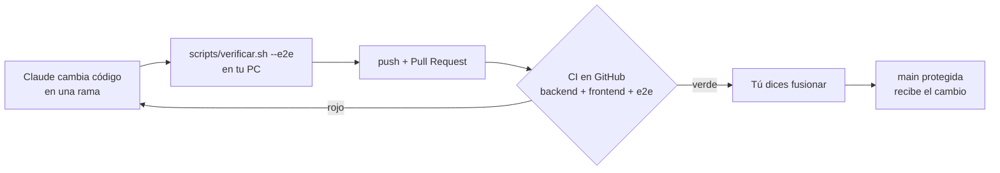

# Cómo funciona appFinanzas por dentro

Guía para Rodrigo. No hace falta saber programar: cada término raro se explica la primera vez
que aparece y hay un glosario al final (sección 6). Los nombres entre `comillas raras` son
archivos o funciones reales de tu repo, para que puedas ir a mirarlos.

Una analogía que usaremos todo el rato: **la app es un restaurante**.

| Restaurante | appFinanzas | Dónde vive |
| --- | --- | --- |
| El comedor y la carta | El **frontend**: lo que ves en el navegador | `frontend/src/` |
| El mesero | La **API**: recibe pedidos y devuelve platos | `backend/app/routers/` |
| La cocina y sus recetas | Los **services**: las reglas de negocio | `backend/app/services/` |
| La despensa | La **base de datos** SQLite (`finance.db`) | `data/` (real), `data-dev/` |
| El inspector de sanidad | Los **tests** y el **CI** | `backend/tests/`, `e2e/`, `.github/` |

---

## 1. La app en una frase y el viaje de un gasto

**En una frase:** una web que funciona solo en tu ordenador, donde cada movimiento se guarda en
la moneda de su cuenta *y* en tu moneda principal, convertido con la tasa del día en que ocurrió.

### El viaje de un gasto, paso a paso

Imagina que apuntas "Mercadona, 45,30 EUR" en tu cuenta de euros y tu moneda principal es MXN.



1. **El formulario.** Rellenas `components/formularios/FormularioTransaccion.tsx` (o el de gasto
   rápido, `FormularioGastoRapido.tsx`). Al pulsar Guardar, el formulario llama a
   `ejecutar(...)` del hook `useEnvio` (`hooks/useEnvio.ts`), que desactiva el botón mientras se
   guarda y, si algo falla, guarda el mensaje de error para enseñártelo.
2. **El pedido sale del comedor.** `ejecutar` llama a `transaccionesApi.crear(datos)`
   (`api/recursos.ts`), que a su vez usa `api/cliente.ts`. Ese archivo es **el único** que
   habla con el backend (con la función del navegador `fetch`). Envía un `POST /api/transacciones`
   con los datos en formato JSON (texto estructurado). Los importes viajan como texto
   (`"45.30"`), no como número, para no perder precisión.
3. **¿Quién recibe el pedido?** Depende de cómo esté arrancada la app:
   - En **desarrollo** (Docker en tu PC), Vite, el servidor del frontend, reenvía todo lo que
     empiece por `/api` al backend y le quita el `/api` (`frontend/vite.config.ts`, `proxy`).
   - En **producción** (el `.exe` o la imagen Docker publicada), `backend/app/servidor.py` monta
     la API bajo `/api` y la web en `/`, todo en un solo servidor.
4. **La puerta.** Antes de llegar al mesero, el portero `ProteccionLocal`
   (`seguridad_http.py`) comprueba que la petición viene de tu propio ordenador y de tu propia
   app. Después, `requiere_sesion` (`dependencias.py`, aplicada en `main.py`) comprueba que
   has iniciado sesión; si no, responde 401 y el frontend te enseña la pantalla de login.
5. **El mesero.** `routers/transacciones.py`, función `crear_transaccion`. No piensa: solo
   recibe los datos ya validados con el **schema** `TransaccionCreate` (que el importe sea
   positivo, que la fecha sea una fecha...) y pasa el pedido a la cocina: `servicio.crear(...)`.
6. **La cocina.** `services/transacciones.py`, función `crear`:
   - `validar_relaciones`: que la cuenta y la categoría existan y que no uses una categoría de
     ingreso para un gasto.
   - `completar_montos`: aquí ocurre la magia multidivisa (sección 3). Llama a
     `services/divisas.py` para asegurarse de que hay tasas (`asegurar_tasas_del_dia` y
     `asegurar_tasas_historicas`) y calcula dos importes con `divisas.convertir`:
     `monto_cuenta` (en la moneda de la cuenta, mueve el saldo) y `monto_principal`
     (en tu moneda principal, alimenta el panel).
7. **La despensa.** `guardar` (`services/comun.py`) añade la fila a la tabla `transaccion` de
   SQLite y confirma (*commit*). La fila queda con: `monto=45.30`, `moneda=EUR`,
   `monto_cuenta=45.30`, `monto_principal≈900` MXN, `fecha`, `categoria_id`, `cuenta_id`.
8. **El plato vuelve.** El router responde `201 Created` con la transacción guardada. Si algo
   salió mal en la cocina, el service lanza un `ErrorDeDominio` (`services/errores.py`) y
   `main.py` lo traduce a un mensaje en español, que el formulario te muestra.
9. **El panel se entera.** `pages/DashboardPage.tsx` pide con `useDatos` varias cosas a la vez a
   `api/dashboard.ts`: `/dashboard/resumen`, `/flujo-mensual`, `/gastos-por-categoria`...
   En la cocina, `services/dashboard.py` hace sumas como `func.sum(Transaccion.monto_principal)`
   del mes. Siempre suma `monto_principal`, nunca `monto`: así se pueden sumar euros y pesos.
10. **Los widgets.** Las respuestas se reparten entre los widgets definidos en
    `components/dashboard/registroWidgets.tsx` (balance, ingresos, gastos, patrimonio,
    calendario...). Tu gasto aparece en el gráfico y en el total del mes.

---

## 2. Las piezas (mapa)

```text
             TU NAVEGADOR
  +------------------------------------+
  |  FRONTEND  (frontend/src)          |   React + TypeScript + Tailwind
  |  pages/ -> components/ -> api/     |
  +-----------------|------------------+
                    | HTTP  /api/...
  +-----------------v------------------+
  |  BACKEND  (backend/app)            |   Python + FastAPI
  |  main.py / servidor.py (entrada)   |
  |  routers/   = meseros              |
  |  services/  = cocina (reglas)      |
  |  models.py  = forma de las tablas  |
  |  schemas.py = forma de los pedidos |
  +-----------------|------------------+
                    | SQL
  +-----------------v------------------+
  |  SQLite: un solo archivo           |
  |  finance.db                        |
  +------------------------------------+
```

**Frontend** (`frontend/src/`). Lo que ves y tocas. Hecho con React (piezas reutilizables de
pantalla llamadas *componentes*), TypeScript (JavaScript con tipos, que avisa de errores antes de
ejecutar) y Tailwind (estilos con clases cortas). Las pantallas están en `pages/`, las piezas en
`components/`, y la comunicación con el backend en `api/`. Las rutas (qué URL abre qué página)
están en `App.tsx`.

**Backend** (`backend/app/`). El programa en Python que guarda y calcula. Está en capas, y cada
una tiene un trabajo:
- **routers/**: los meseros. Una función por "endpoint" (dirección + verbo, por ejemplo
  `POST /transacciones`). No tienen lógica; solo reciben y delegan.
- **services/**: la cocina. Aquí están las reglas: cómo se convierte una moneda
  (`divisas.py`), cómo se lee un extracto (`lector_extractos.py`), qué es una transferencia
  (`transferencias.py`), cómo se calcula el panel (`dashboard.py`).
- **models.py**: la forma de cada tabla de la despensa (qué columnas tiene `Transaccion`,
  `Cuenta`...).
- **schemas.py**: la forma de los pedidos y respuestas (`TransaccionCreate` es lo que el
  navegador puede mandar; `TransaccionRead` lo que se le devuelve). Separarlos evita, por
  ejemplo, que el navegador te cuele un `monto_principal` inventado.

**Base de datos** (`data/finance.db`). SQLite: toda la base de datos es un único archivo.
`database.py` es el único que sabe dónde está; al arrancar, `init_db` crea las tablas, aplica
`migraciones.py` y mete los datos iniciales (`datos_iniciales.py`, por ejemplo las categorías).

**Tests del backend** (`backend/tests/`). Pequeños programas que usan la app y comprueban el
resultado. Cada test usa una base de datos en memoria, vacía y desechable (`conftest.py`).

**E2E** (`e2e/*.mjs`). Pruebas "de punta a punta": un navegador automático (Playwright) abre la
app de verdad y hace clics como lo harías tú. Lo lanza `scripts/e2e.sh` con una BD temporal.

**CI** (`.github/workflows/ci.yml`). Cada vez que subes una rama a GitHub, unos ordenadores de
GitHub ejecutan los linters, los tests, la comprobación de tipos, las auditorías de seguridad
de dependencias y los E2E. Si algo falla, la PR sale en rojo.

**Release** (`.github/workflows/release.yml`). Al subir una etiqueta `v1.2.0`, GitHub compila la
web, fabrica el ejecutable de Windows y de Linux, construye la imagen Docker (la publica en
`ghcr.io`) y crea la página de la versión con los archivos y sus huellas `SHA256SUMS.txt`.

**Docker** (`Dockerfile`, `docker-compose.yml`). Docker mete un programa con todo lo que necesita
en una "caja" (contenedor). `docker-compose.yml` es para desarrollo: dos cajas (backend en el
puerto 8000 y frontend en el 5173), que leen tu código en vivo y usan la BD de `data-dev/`. El
`Dockerfile` de la raíz es la imagen de producción, en dos etapas: primero compila la web con
Node y luego deja solo Python más la web ya compilada.

**El .exe** (`backend/app/lanzador.py` + `empaquetado/appfinanzas.spec`). PyInstaller empaqueta
Python, el backend y la web en un único ejecutable. Al hacer doble clic, `lanzador.py` busca
la carpeta de datos (`%APPDATA%\AppFinanzas`), elige un puerto (8765 si está libre), arranca el
servidor solo en `127.0.0.1` y abre el navegador. Si la app ya estaba abierta, solo abre otra
pestaña.

---

## 3. Cómo se guarda el dinero

### Decimal, nunca float

Los ordenadores guardan los números con decimales (*float*) de forma aproximada. En
`models.py` lo dice un comentario: con float, `0.1 + 0.2` da `0.30000000000000004`. Para el
dinero eso es inaceptable, así que todo importe es `Decimal`: un número decimal exacto, con
hasta 12 dígitos y 2 decimales (`MAX_DIGITOS`, `DECIMALES`). Hasta el frontend respeta esto:
los importes viajan como texto (`"45.30"`). Un test (`test_dashboard.py`) comprueba que unos
gastos suman exactamente `"300.30"`. Incluso al recibir una tasa de internet, `divisas.py` hace
`Decimal(str(valor))` para no arrastrar el error del float.

Los importes siempre son positivos; el signo lo pone el `tipo` (ingreso suma, gasto resta).

### Tres importes por movimiento

| Campo | Qué es | Para qué sirve |
| --- | --- | --- |
| `monto` + `moneda` | Lo que pagaste, en la moneda en que pagaste | El dato original |
| `monto_cuenta` | Convertido a la moneda de la cuenta | Mueve el saldo de la cuenta |
| `monto_principal` | Convertido a tu moneda principal | Panel, presupuestos, gráficos |

La clave: se convierte **con la tasa de la fecha del movimiento**, no con la de hoy. Un gasto
de marzo vale siempre lo mismo aunque hoy el euro haya subido. Por eso el panel de hace seis
meses no cambia cada día.

### De dónde salen las tasas

Todas las tasas se guardan respecto al dólar ("unidades por 1 USD") en la tabla `tasacambio`,
una por moneda y día. Para pasar de EUR a MXN se pasa por el dólar:
`100 EUR → MXN = 100 / tasa(EUR) × tasa(MXN)`.

- **Hoy:** `open.er-api.com` (ExchangeRate-API), gratis y sin clave, incluye las 5 monedas
  (MXN, USD, EUR, GTQ, HNL). Se descarga al arrancar, en segundo plano para no retrasar la
  apertura, y cuando se necesita (`asegurar_tasas_del_dia`).
- **Días pasados:** las del Banco Central Europeo, vía `api.frankfurter.dev`, desde 1999
  (`asegurar_tasas_historicas`). Solo cubren EUR y MXN; para GTQ y HNL se usa la guardada más
  cercana.
- **A mano:** puedes escribir una tasa en Ajustes. Una tasa manual manda sobre la descargada.

### Y si no hay tasa

- Fines de semana y festivos no tienen tasa: se usa la del día anterior más cercano (hasta 6
  días no se considera un hueco).
- Si no hay internet, la app no se queda colgada: tras un fallo espera una hora antes de
  reintentar (`_SEGUNDOS_ENTRE_REINTENTOS`) y mientras usa las últimas tasas guardadas.
- Si la fecha es anterior a la primera tasa guardada, usa la más antigua que haya.
- Si no existe **ninguna** tasa de esa moneda, el guardado falla con un mensaje claro: "No hay
  tasa de cambio para X. Actualízalas o escríbela en Ajustes."
- Al arrancar, la app rellena los días pasados que no tenían tasa y vuelve a convertir lo que se
  guardó con una tasa aproximada (`recalcular_montos_desde`).
- Las tasas descargadas se validan: si llegan datos absurdos (fuera de rango, no numéricos), se
  descartan.

---

## 4. Las decisiones de arquitectura y por qué

**SQLite local en vez de la nube o PostgreSQL.** El README lo dice como promesa: "Tus datos se
quedan contigo: no hay cuentas en la nube". SQLite es un único archivo, sin servidor aparte:
copiarlo es hacer una copia de seguridad (botón "Descargar copia completa"). La hoja de ruta, en
"Por ahora no", descarta la nube multiusuario porque exigiría RGPD, un `usuario_id` en todas las
tablas, PostgreSQL y verificación en dos pasos. Para el futuro está apuntada una alternativa más
modesta: sincronización *cifrada* del archivo en tu propia nube.

**FastAPI + React en vez de un programa de escritorio.** No encontré escrito el porqué.
Probablemente: el mismo código sirve para el `.exe`, Docker y el móvil (la web se ve en el
navegador del teléfono), y React tiene muchas piezas listas (gráficos con Recharts, arrastrar
widgets con dnd-kit). La hoja de ruta sí descarta una "app nativa o Capacitor" porque obligaría a
*duplicar la lógica de divisas*, y propone en su lugar una PWA (la web instalada como ventana).

**Esquema solo aditivo y migraciones caseras en vez de Alembic.** `migraciones.py` lo explica:
`create_all` crea tablas nuevas pero no toca las existentes, así que al arrancar se añaden las
columnas que falten. Solo se permiten columnas opcionales (*nullable*): así una versión nueva
nunca rompe tu `finance.db` ni obliga a borrarlo. Alembic (la herramienta estándar) se descarta
"por si acaso"; el propio archivo dice que si algún día hace falta renombrar o borrar columnas,
convendrá adoptarla.

**Un servidor en producción, dos en desarrollo.** En desarrollo, Vite (frontend, puerto 5173)
recarga la pantalla al instante cuando Claude cambia el código, y uvicorn (backend, 8000) se
reinicia solo con `--reload`. En producción no hace falta nada de eso: `servidor.py` une API y
web en un solo puerto. Ventaja de ambos: el navegador siempre habla con un único origen, así que
no hace falta CORS (un permiso especial entre webs distintas), como explica `main.py`.

**PyInstaller (.exe) y Docker.** El `.exe` es para el usuario normal: doble clic y listo, sin
instalar Python. Docker es "para usuarios técnicos" (README) y para servidores caseros. Los dos
salen de la misma receta de release.

**ProteccionLocal.** Aunque la app solo escucha en `127.0.0.1`, tu navegador visita otras webs, y
una web maliciosa podría intentar hablar con tu app local. `seguridad_http.py` pone cuatro
defensas: solo acepta el Host `127.0.0.1`/`localhost` (frena el "DNS rebinding"), solo acepta
escrituras que vengan de la propia app (Origin), limita las peticiones a 1 MB y añade cabeceras
como la CSP (solo se ejecutan scripts de la propia app). Está escrita "a mano" para no copiar en
memoria cada respuesta. En desarrollo se activa sin las cabeceras, porque la CSP rompería `/docs`.

**Páginas perezosas y caché de `useDatos`.** `paginas.ts` explica que el Dashboard va en el
paquete principal y el resto de páginas se descargan aparte: la app abre antes, y
`precargarPagina` las trae por detrás. `useDatos` guarda en memoria la última respuesta de cada
página (hasta 40): al volver a una página se pinta lo de antes al instante y, por detrás, se
piden datos frescos ("stale-while-revalidate"). Así la pantalla no parpadea.

**GPL-3.0.** El README: puedes usar, estudiar, modificar y compartir la app, pero quien
distribuya una versión modificada debe mantenerla libre. La hoja de ruta avisa de que choca con
la App Store y que hay que decidir la licencia antes de vender nada.

---

## 5. Cómo se protege que nada se rompa



- **Tests unitarios** (`backend/tests/test_*.py`, con *pytest*): cada uno prueba una regla
  concreta ("un gasto en EUR en una cuenta MXN mueve el saldo así"). Nunca usan internet ni tus
  datos. Regla de la casa: al arreglar un fallo, primero se escribe un test que lo reproduzca y
  se comprueba que falla sin el arreglo.
- **Tests de propiedades** (`test_propiedades.py`): en vez de un caso, hacen muchas operaciones
  al azar (crear, editar y borrar gastos, ingresos y transferencias en MXN y EUR) y comparan con
  un "modelo de referencia" en Python puro que calcula lo que *debería* haber. La semilla es fija:
  si falla, se puede repetir exactamente.
- **E2E con Playwright** (`e2e/`): un navegador real recorre la app. `humo.mjs` lee las rutas de
  `App.tsx` y comprueba que todas las páginas cargan sin errores; otros prueban importar, metas,
  presupuestos, avisos...
- **Linters y tipos**: `ruff` (Python) y `eslint` (frontend) detectan errores típicos y estilo;
  `tsc` comprueba los tipos de TypeScript.
- **`scripts/verificar.sh`**: lo mismo que el CI, en tu PC, dentro de contenedores desechables.
- **CI en GitHub** (`ci.yml`): repite todo en cada PR y además audita las dependencias en busca de
  fallos de seguridad conocidos (`pip-audit`, `npm audit`).
- **`main` protegida**: nadie (ni Claude) puede subir directamente a `main`. Todo entra por pull
  request, con el CI en verde y la rama al día. Esto nació de un susto real (22/10/2026, en
  `docs/como-trabajamos.md`).

---

## 6. Glosario

| Término | Qué es (y un ejemplo tuyo) |
| --- | --- |
| API | El "mesero": conjunto de direcciones a las que el frontend pide cosas. Todo bajo `/api`. |
| Endpoint | Una dirección + verbo de la API: `GET /dashboard/resumen`. |
| Router | Archivo que agrupa endpoints de un tema: `routers/transacciones.py`. |
| Service | Donde viven las reglas de negocio: `services/divisas.py`. |
| Model | Forma de una tabla de la BD: `class Transaccion` en `models.py`. |
| Schema | Forma de un pedido o respuesta: `TransaccionCreate` en `schemas.py`. |
| Migración | Cambio en la estructura de la BD existente: añadir una columna (`migraciones.py`). |
| Middleware | Capa que revisa todas las peticiones antes del router: `ProteccionLocal`. |
| Commit | Una "foto" guardada de cambios en git: `docs: react-router 7 y limpieza hechos`. |
| Rama | Línea de trabajo separada de `main`: `feat/react-router-7`. |
| PR (pull request) | Propuesta de meter una rama en `main`, revisable en GitHub (la #30). |
| Merge | Fusionar una rama en otra; en GitHub, "Merge pull request". |
| Conflicto | Dos ramas cambiaron la misma línea; hay que combinarlas a mano. |
| CI | Comprobaciones automáticas en GitHub en cada PR (`ci.yml`). |
| Worktree | Segunda carpeta del mismo repo en otra rama: `appFinanzas-<tarea>`. |
| Docker | Programa que ejecuta apps dentro de cajas aisladas. |
| Contenedor | Una de esas cajas en marcha: el `backend` de `docker-compose.yml`. |
| Build | Compilar la web a archivos finales: `npm run build` crea `frontend/dist`. |
| Bundle / chunk | Paquete de código que baja el navegador; `vite.config.ts` separa `graficas`. |
| Lazy loading | Descargar una página solo cuando hace falta: `paginas.ts`. |
| Componente | Pieza de pantalla reutilizable de React: `TarjetaMetrica`. |
| Props | Datos que se le pasan a un componente: el `valor` de una tarjeta. |
| Estado | Lo que un componente recuerda mientras está en pantalla: `enviando` en `useEnvio`. |
| Hook | Función de React que da "superpoderes" a un componente: `useDatos`, `useEnvio`. |
| Caché | Copia guardada para no repetir trabajo: la de `useDatos`, o la de tasas en la sesión. |
| Decimal | Número decimal exacto, usado para todo el dinero (`monto`). |
| Test | Programa que comprueba que otro funciona: `test_transferencias.py`. |
| E2E | Test que usa la app entera en un navegador: `e2e/importar.mjs`. |
| Mock / simulación | Sustituir algo real en un test: se simula `_pedir_json` (sin internet). |
| Tag / release | Etiqueta de versión (`v1.2.0`): dispara `release.yml` y publica el .exe. |
| Dependencia | Librería ajena que usamos: `fastapi`, `recharts`. |
| Lockfile | Lista de versiones exactas: `package-lock.json`, `backend/constraints.txt`. |

---

## 7. "Si quisieras tocar X, mira Y"

Rutas cortas: `fe/` = `frontend/src/`, `be/` = `backend/app/`.

| Quiero... | Mira... |
| --- | --- |
| 1. Añadir un widget al panel | `fe/components/dashboard/registroWidgets.tsx` (`WIDGETS`) |
| 2. Una moneda nueva (GBP) | `be/models.py` (`Moneda`), `fe/config.ts`, `divisas.py` |
| 3. Leer el formato de un banco nuevo | `be/services/lector_extractos.py` + test con archivo |
| 4. Reconocer transferencias al importar | `be/services/importaciones.py` |
| 5. Cambiar colores o crear un estilo | `fe/index.css` (tokens, `[data-estilo=...]`) |
| 6. Un campo nuevo en transacciones | `be/models.py`, `be/schemas.py`, `fe/types/`, formulario |
| 7. Una página nueva | `fe/pages/`, `fe/paginas.ts`, `fe/App.tsx`, `fe/components/Layout.tsx` |
| 8. Cambiar un cálculo del panel | `be/services/dashboard.py` + `tests/test_dashboard.py` |
| 9. Reglas de saldos o tarjetas | `be/services/saldos.py`, `be/services/cuentas.py` |
| 10. Un aviso en la campana | `be/services/notificaciones.py`, `fe/hooks/useNotificaciones.ts`|
| 11. Login y contraseñas | `be/seguridad.py`, `be/services/acceso.py`, `be/main.py` |
| 12. Publicar una versión | `be/version.py`, `frontend/package.json`, `CHANGELOG.md`, tag `v*` |
| 13. Puerto o datos del .exe | `be/lanzador.py` (`PUERTO_PREFERIDO`, `carpeta_de_datos`) |

Detalles que conviene saber de algunas filas:
- **1.** Si el widget necesita datos nuevos, además: `be/services/dashboard.py`,
  `be/routers/dashboard.py`, `fe/api/dashboard.ts` y `fe/pages/DashboardPage.tsx`.
- **2.** También `fe/types/index.ts`. El BCE da tasas históricas de GBP y CHF (está en la hoja de
  ruta); habría que añadirlas a `MONEDAS_HISTORICAS`.
- **3.** Un extracto de ejemplo (con datos cambiados) va en `backend/tests/datos/`, y su test en
  `test_lector_extractos.py`. El lector no sabe nada de la BD: por eso es fácil de probar.
- **6.** La columna debe ser opcional (*nullable*); la migración se aplica sola al arrancar.
  El formulario es `fe/components/formularios/FormularioTransaccion.tsx`.
- **7.** El E2E de humo (`e2e/humo.mjs`) la probará solo, porque lee las rutas de `App.tsx`.

Y para cualquiera de estos: pídelo a Claude con `/nueva-tarea`, y si algo no queda claro,
`/explicame <archivo o concepto>`.
